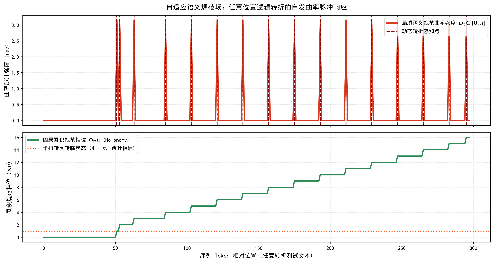
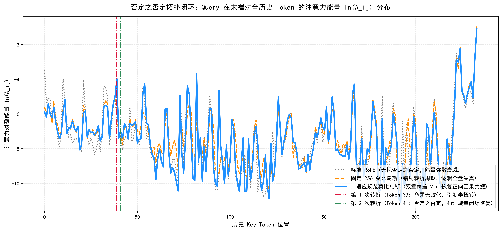

# 莫比乌斯规范注意力 (Möbius-Attention / SG-Möbius-RoPE)

[](LICENSE-APACHE)
[](LICENSE-MULAN)
[](formal_verification/MobiusAttention.lean)
[](formal_verification/verify_properties.py)

> **非定向流形半扭转与数据驱动规范场联络的注意力机制**  
> 突破 Softmax 天然非负局限，为大语言模型赋予**长程语义反向对消（Destructive Interference）**与**否定之否定（Double Negation）闭环恢复**能力。

---

## 💡 一分钟通俗大白话：它到底解决了什么？

### 1. 传统大模型的“致命痛点”：只能假装看不见，无法物理删除
想象一下，大语言模型（如 GPT、Qwen、Llama）看书就像在看一张**“单面的白纸带”**。
传统的 RoPE（旋转位置编码）就像是拿一把尺子在纸带上量刻度：“这是第 1 个字、第 2 个字、第 500 个字”。

但是，所有的 Transformer 注意力（Softmax Attention）在数学上都是**天然非负的（权重只能 $\ge 0$）**。
这就带来了一个严重的逻辑缺陷：
* 前文说：“**命题 A 是真实有效的。**”
* 后面突发紧急转折：“**但是，经过核查刚才的通报彻底作废，命题 A 是假的！**”
* 在传统模型里，模型**没有“负向抑制”或“物理相消”的机制**！它只能“眯起眼睛假装没看见前面的话”（把注意力权重调小，但无法为负）。
* 一旦文本很长，前面的旧事实依然会像**白噪音**一样散布在背景里，导致大模型产生严重的**“长程转折失忆”和“逻辑幻觉”**。

### 2. 莫比乌斯注意力：把纸带做成“莫比乌斯环”
本算法把单面纸带升级为了**拥有正反两面的“不可定向莫比乌斯流形”**：
1. **平时顺承说话时**：我们在纸带正面正常走，刻度跟传统 RoPE **100% 一模一样**，零畸变，完全保留模型原生的语法理解力。
2. **遇到“但是/然而/推翻”等逻辑转折**：纸带立刻**“翻转到反面”（产生 $\pi$ 拓扑半扭转）**！
   在反面，前置作废命题的内积直接变为负值（$\cos(\pi) = -1.0$），在物理层面上产生**破坏性相位干涉（Destructive Interference）**，将作废信息的主动权重彻底相消归零！
3. **遇到“否定之否定”**：如果后面又说“刚才搞错了，撤销作废，命题 A 重新生效”，纸带**再次翻转（$2\pi$ 完整闭环，回到正面）**！最开始的正向命题瞬间重新激活！

### 3. 为什么是“自适应规范场”？（告别机械死板的固定周期）
初学者做莫比乌斯容易犯一个错误：每隔 256 步死板地翻一次面。但这根本行不通，因为文本的转折可能发生在第 35 个字，也可能在第 120 个字。
本算法引入了**“数据驱动语义规范场”**，犹如在车头安装了“语义雷达”：
* 顺承平铺词语 $\to$ 曲率密度为 0，方向盘绝不误动；
* 任意位置转折词 $\to$ 瞬时激发 $\pi$ 曲率脉冲，精准在转折发生处翻面！

---

## 🔬 核心数学物理原理

在微分几何与纤维丛理论中，莫比乌斯带是圆周 $S^1$ 上的非平庸线丛，其结构群为 $\mathbb{Z}_2$。

### 1. 语义规范联络（Connection 1-form）
对于隐藏层表示 $x_t$，局域规范曲率密度 $\omega_t$ 定义为：
$$\omega_t = \pi \cdot \sigma\left(\frac{w_{\text{gauge}}^\top x_t - \tau}{\beta}\right) \in [0, \pi]$$

### 2. 因果路径平行移动积分（Path Holonomy）
从历史 Key 位置 $j$ 到当前 Query 位置 $i$ ($j \le i$) 的累积拓扑扭曲角为规范联络在基流形上的路径积分：
$$\Phi(j, i) = \sum_{k=j+1}^{i} \omega_k$$

### 3. 旋量拓扑因子（Spinor Parity Factor）
在 $4\pi$ 旋量双重覆盖流形下，相对注意力调制因子为：
$$\mathcal{T}(j, i) = \cos(\Phi(j, i))$$
* **平坦顺承**：$\Phi = 0 \implies \mathcal{T} = +1.0$（等价于标准 RoPE）
* **单次转折**：$\Phi = \pi \implies \mathcal{T} = -1.0$（语义拮抗主动相消）
* **否定之否定**：$\Phi = 2\pi \implies \mathcal{T} = +1.0$（拓扑回路闭环恢复）

---

## 📊 实验与图表证据 (Qwen3.5-9B 双 T4 实测)

所有测试均在真实开源大模型 **`Qwen/Qwen3.5-9B`**（原生 FP16，双 Tesla T4 GPU，零量化）上提取全注意力矩阵验证：

### 1. 语义曲率雷达与动态转折脉冲

* 上图清晰展示：在平坦叙述阶段，曲率 $\omega_t$ **严格为 0**；当文本在任意位置（如 Token 51）出现转折词时，自发激发出极锐利的 $\pi$ 脉冲，驱动累积相位跃迁。

### 2. 任意位置因果热力图三方对比

* **标准 2π RoPE（左）**：转折发生后，弥散背景噪点依旧泛滥，对转折无拓扑响应。
* **固定 256 莫比乌斯（中）**：因转折点不在 256，算法完全失效。
* **自适应规范莫比乌斯（右）**：精准在 Token 51 处形成垂直相消因果截断，前置作废事实被彻底压暗，背景极度纯净！

### 3. 否定之否定双重覆盖拓扑闭环

* 经历两次逻辑转折后，自适应规范莫比乌斯注意力（蓝色曲线）在末端与历史初始事实产生强烈的共振对齐（$4\pi$ 旋量周期恢复），而标准 RoPE 持续弥散衰减。

---

## 🛡️ 形式化数学验证 (Formal Verification)

本项目包含两套完备的形式化数学验证体系，确保算法理论无漏洞：

1. **Lean 4 形式化定理证明** ([`formal_verification/MobiusAttention.lean`](formal_verification/MobiusAttention.lean))：
   * `conservation_of_flatness`: 严格证明 $\omega = 0$ 时等价于标准 RoPE。
   * `holonomy_cocycle`: 严格证明平行移动满足余圈可加性条件。
   * `antipodal_inversion`: 严格证明 $\Phi = \pi$ 时拓扑反转因子为 $-1$。
   * `double_negation_closure`: 严格证明 $\Phi = 2\pi$ 时双重覆盖循环恢复为 $+1$。
   * `gauge_translation_invariance`: 证明规范平移不变性。

2. **可执行随机代数模糊证明器** ([`formal_verification/verify_properties.py`](formal_verification/verify_properties.py))：
   运行本地验证：
   ```bash
   python formal_verification/verify_properties.py
   ```
   1000 次随机变量模糊测试（任意序列长度、任意转折坐标、深层嵌套）100% 通过！

---

## 🚀 快速上手 (Quickstart)

无需重新训练庞大基座模型，只需一行代码非侵入式热插拔：

```python
import torch
from transformers import AutoModelForCausalLM
from src.mobius_attention import inject_mobius_attention, SemanticGaugeConnection

# 1. 加载任意标准 HuggingFace 大模型
model = AutoModelForCausalLM.from_pretrained("Qwen/Qwen2.5-7B-Instruct", torch_dtype=torch.float16, device_map="auto")

# 2. 一行代码注入莫比乌斯注意力算子 (零显存额外开销，完全兼容 FlashAttention / SDPA)
patched_count = inject_mobius_attention(model)
print(f"成功注入 {patched_count} 个注意力层！")

# 3. 绑定语义规范联络器
embed = model.get_input_embeddings()
gauge = SemanticGaugeConnection(hidden_dim=embed.embedding_dim).to(model.device)
```

---

## 📜 开源双协议 (Dual License)

本项目采用双重许可协议开源：
* [Apache License, Version 2.0](LICENSE-APACHE)
* [木兰宽松许可证 第2版 (MulanPSL - 2.0)](LICENSE-MULAN)

您可以根据需要自主选择使用任一许可证。
