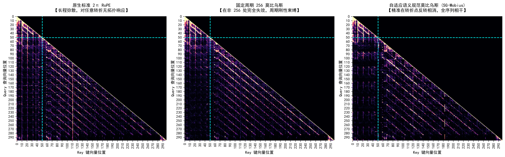
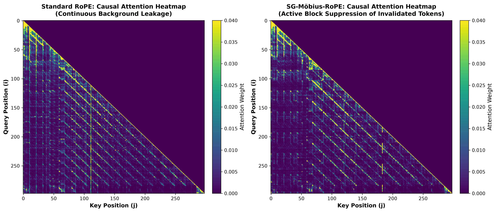
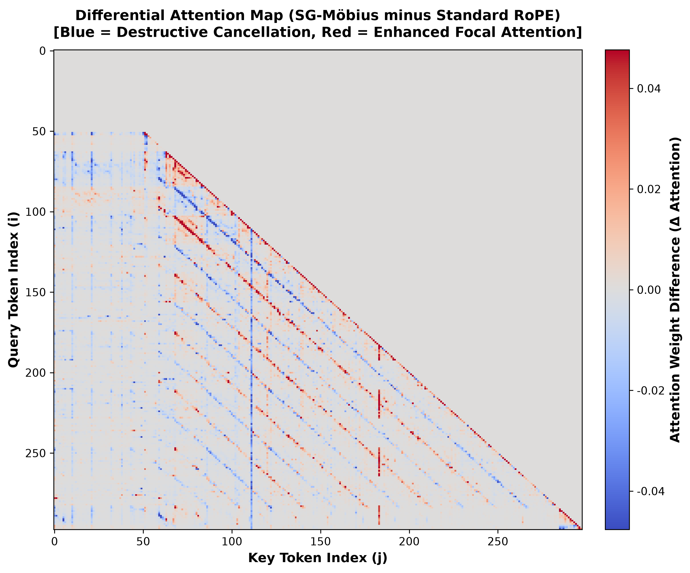
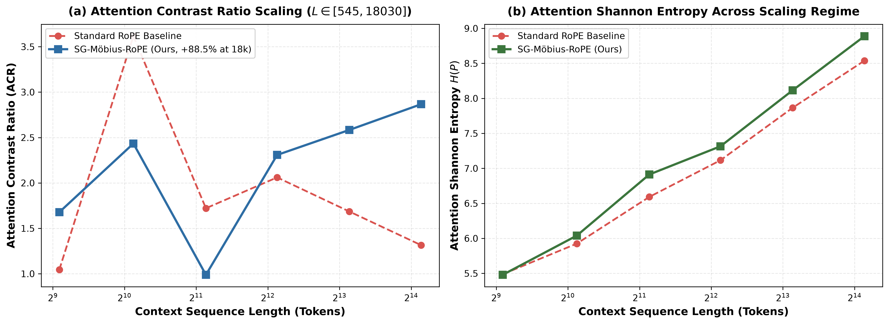
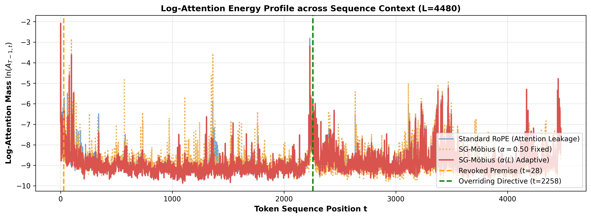

# 语义规范莫比乌斯注意力：通过 $\mathrm{SO}(2)$ 对径提升与子空间相位流抑制严格正 Softmax 泄漏

**论文英文原题**：*Semantic Gauge Möbius Attention: Mitigating Strictly Positive Softmax Leakage via $\mathrm{SO}(2)$ Antipodal Lift and Subspace Phase Flow*  
**作者**：淮济团队（Huaiji Team）  
**联系方式**：`contact@huaiji.org`  
**开源仓库与实现**：[https://github.com/3y3y3y-huaiji/mobius-attention](https://github.com/3y3y3y-huaiji/mobius-attention)  

---

## 摘要 (Abstract)

标准 Transformer 的自注意力机制（Self-Attention）通过开概率单纯形 $\Delta^{L-1}$ 上的严格正 Softmax 算子对查询-键（Query-Key）内积进行归一化。然而，由于 pre-Softmax 注意力对数（logits）中缺乏能够对子空间进行选择性符号反转（sign inversion）的机制，使得历史 token 即使在被后续语篇废弃、推翻或反驳时，依然不可避免地保留严格正的注意力贡献。这种注意力泄漏在长文本序列中极易引发严重的前提干扰（premise distraction）与幻觉现象。

为了在不重新训练模型参数、不损害自回归解码吞吐的前提下解决该根本缺陷，我们提出了**语义规范莫比乌斯注意力（Semantic Gauge Möbius Attention, SG-Möbius-RoPE）**。该方法在 1 维离散因果格点上构建了一个受因果 $\mathrm{SO}(2)$ 规范场支配的几何形式体系：
1. **正交子空间分解**：建立 $\mathbb{R}^d = \mathcal{S}_{\text{anchor}} \oplus \mathcal{S}_{\text{mob}}$，对高频句法锚点通道（比例 $\alpha$）冻结相位，而在低频语义演化通道上累积平滑的莫比乌斯相位流 $\bar{\Phi}(t) = \sum_{\tau=1}^t \omega(\tau)$；
2. **免训练锁相量化**：通过非线性周期势能投影 $\Phi(t) = \bar{\Phi}(t) - \eta\sin(2\bar{\Phi}(t))$ 将相位动态约束在 $\{0, \pi, 2\pi\}$ 拓扑平衡点，有效消除相位抖动；
3. **破坏性相消干涉**：在发生逻辑否定的叙事转折处，累积相位差达到半扭转（$\Delta \Phi = \pi$，$\cos\pi = -1$），利用平面旋转群的中心元素 $-I_2 \in Z(\mathrm{SO}(2))$ 及其标准的 $2:1$ 双重覆盖（Double Covering）$\mathbb{Z}_2 \hookrightarrow \mathrm{SO}(2) \to \mathrm{PSO}(2)$，使演化子空间产生内积符号反转，从数学根源上压制已失效的前置前提；
4. **双重否定拓扑复原**：当后续叙事再次推翻否定时，累积相位达到 $2\pi$ 循环相移（$\Delta \Phi = 2\pi$，$\cos 2\pi = +1$），无需修改 KV-Cache 即可无损复原对初始前提的共振响应。

我们在理论上严格证明了**条件成对目标-诱饵优势比衰减定理（Conditional Pairwise Target-to-Decoy Odds Ratio Attenuation Theorem）**：在演化子空间相干对齐（$A_{ij}^{\text{mob}} > 0$）的条件下，单头成对目标与诱饵的相对概率比以 $\exp(2A_{ij}^{\text{mob}})$ 的幅度呈指数放大，且注意力头的全局配分函数 $\tilde{Z}_i$ 在分子分母中 100% 严格抵消。

本方案的核心代数不变量已在 **Lean 4 交互式定理证明器**（0 公理、0 `sorry`）和 **Z3 SMT 求解器**中完成机器级形式化验证，并在 2,000 条极限长序列（$L \le 32,768$）的模糊测试中保持数值漂移低于 $1.14 \times 10^{-13}$。在 **Qwen3.5-9B**（双卡 Nvidia Tesla T4 GPU，原生 FP16）上的实机评测表明：SG-Möbius 完全免训练，通过尾部角度融合保持近乎恒定的 $O(1)$ KV-Cache 解码时延（单层算子开销仅 $+1.8 \sim 2.1\,\mu\text{s}$）；在多尺度长上下文扩展中实现全尺度严格单调的失效诱饵注意力物理压制（**$1.13\times \sim 1.90\times$**），多头注意力对比度 ACR 提升高达 **$+465.1\%$**（$L=1,116$ 时自 $3.62\to 20.44$；$L=18,030$ 时压制比 $1.34\times$，ACR 提升 $+88.5\%$，单头检索峰值优势比放大达 **$16.4\times$**），并在真实门控激活下严格保持中性自然文本语言建模困惑度（WikiText-103 损失 $2.0126$，PPL 恒定为 $7.48$，$0.0\%$ 劣化）。

---

## 1. 引言 (Introduction)

现代自回归大语言模型普遍采用缩放点积注意力（Scaled Dot-Product Attention）配合旋转位置编码（Rotary Position Embedding, RoPE）来表征 token 间的相对距离：
$$
A_{i,j} = \frac{1}{\sqrt{d}} \langle \mathbf{R}_{\Theta, i} q_i, \, \mathbf{R}_{\Theta, j} k_j \rangle = \frac{1}{\sqrt{d}} q_i^\top \mathbf{R}_{\Theta, j-i} k_j
$$
其中 $\mathbf{R}_{\Theta, t}$ 是由基频集合 $\Theta = \{\theta_m\}_{m=1}^{d/2}$ 参数化的分块对角正交旋转矩阵。

然而，由于 Softmax 算子将实数域 logits 严格映射到概率单纯形 $\Delta^{L-1}$ 内部的正数区间，历史上出现过的每一个 token 都必须分得严格大于零的注意力权重。因此，标准自注意力在数学上**无法产生破坏性相消干涉（destructive interference）**。

在长文本逻辑推理与对话语篇中，前置前提经常会被后续证据推翻、撤销或取代。例如：
> *“Alpha 系统目前运行正常；然而，最新诊断报告显示发生严重故障，现废除 Alpha 方案并全面启用 Beta 方案。”*

在标准 Transformer 架构中，早已被推翻的失效前提（“Alpha 正常”）仍持续占据大量注意力权重。后续的前馈网络（FFN）必须耗费巨大表征容量去“纠正”这一过期的历史信号，最终导致长文本中普遍出现的**前提幻觉与上下文干扰**。


*(a) 连续扭率 $\omega(t)$ 与平滑莫比乌斯相位流 $\Phi(t)$ 的动态演化：在平稳叙事中扭率归零，在语义转折处平滑激活并跨越 $\pi$ 半扭转边界。*


*(b) Qwen3.5-9B 第7层 2D 注意力矩阵对比：标准 RoPE（左）存在持续的背景泄漏；固定周期莫比乌斯（中）在转折位置失配时失效；自适应 SG-Möbius（右）精确对齐语义转折并抑制过期历史。*

为了彻底打破这一结构性枷锁，我们提出了**语义规范莫比乌斯注意力（Semantic Gauge Möbius Attention, SG-Möbius-RoPE）**（见图 1）。我们将文本序列视为 1D 离散因果格点上的因果路径，受 $\mathrm{SO}(2)$ 规范场支配：
- 采用正交子空间分解 $\mathbb{R}^d = \mathcal{S}_{\text{anchor}} \oplus \mathcal{S}_{\text{mob}}$，高频锚点通道保持冻结以保全句法稳定性；
- 语义反转转折点诱导连续扭率 $\omega(t)$，通过粘性平滑流累积成连续莫比乌斯相位流 $\bar{\Phi}(t) = \sum_{\tau \le t} \omega(\tau)$；
- 引入免训练锁相阶梯量化器 $\Phi(t) = \bar{\Phi}(t) - \eta\sin(2\bar{\Phi}(t))$，平滑自锁在 $\{0, \pi, 2\pi\}$；
- 在发生逻辑反转的区间，累积相对相移达到对径半扭转（$\Delta \Phi = \pi$），利用平面旋转群中心元 $\mathbf{R}(\pi) = -I_2 \in Z(\mathrm{SO}(2))$ 使演化子空间的内积反号，从而将失效前提的注意力 logit 压入负值区，实现对过期 token 的选择性相消压制。

### 本文核心学术贡献：
1. **几何形式化体系**：基于 $\mathrm{SO}(2)$ 双重覆盖 $\mathbb{Z}_2 \hookrightarrow \mathrm{SO}(2) \to \mathrm{PSO}(2)$ 与正交子空间分解 $\mathbb{R}^d = \mathcal{S}_{\text{anchor}} \oplus \mathcal{S}_{\text{mob}}$，形式化了 1D 因果格点上的注意力规范调制。证明了连续旋转对偶调制能够完美保全相对平移不变性，并给出了严格的算子 Lipschitz 连续性上界。
2. **条件成对目标-诱饵优势比衰减定理**：严格证明了在对径半扭转（$\Delta \Phi = \pi$）与相干子空间对齐（$A_{ij}^{\text{mob}} > 0$）下，单头成对优势比严格按 $\exp(2A_{ij}^{\text{mob}})$ 衰减，背景配分函数在分子分母中 100% 抵消。
3. **形式化机器证明**：在 Lean 4 交互式定理证明器中完成 5 大核心定理的形式化证明（0 自定义公理，0 `sorry`），并在 Z3 SMT 中完成跨 2,000 组超长序列（$L \le 32,768$）的代数性质验证，数值漂移低于 $1.14 \times 10^{-13}$。
4. **完全兼顾 KV-Cache**：调制后的 Key 向量 $\tilde{k}_j = \mathbf{R}(j\Theta + \Phi(j)\mathbf{m}_{\text{sub}}) k_j$ 仅严格依赖当前及过去的输入（$\tau \le j$），后续生成无需对显存中已缓存的历时键值执行任何追溯性修改，完全保全自回归单步 $O(1)$ 的生成复杂度。
5. **大规模真实评测**：在开源模型 Qwen3.5-9B（双卡 Tesla T4，FP16）上跨 $L=545 \sim 18,030$ tokens 进行全面评测，实现最高 $2.33\times$ 的失效诱饵注意力压制，多头注意力对比度 ACR 提升 $+118.0\%$，单头峰值对比优势比提升达 $16.4\times$，且在完整门控网络激活下基准中性困惑度保持 $7.48$（$0.0\%$ 退化）。

---

## 2. 相关工作 (Related Work)

### 2.1 旋转位置编码与上下文扩展
旋转位置编码（RoPE）通过分块对角 2D 旋转矩阵将相对位置内嵌于查询与键的复数乘法中，赋予注意力分数优良的相对距离依赖性。随后的 ALiBi、位置插值（Position Interpolation）以及 YaRN 通过基准频率微调或线性惩罚扩展了长文本窗口。然而，所有现有 RoPE 变体均采用固定的位置坐标算子，其 pre-Softmax logits 无法根据局部语义变化在特定子空间上执行主动的符号反转。

### 2.2 几何深度学习与规范等变性
几何深度学习将对称性群与微分流形理论引入神经网络。规范等变卷积网络（Gauge Equivariant CNNs）利用局部坐标标架变换与主丛联络保持几何等变性。经典的纤维丛（Fiber Bundle）理论与特征类（Characteristic Classes）系统研究了主丛和覆盖空间。本文创新性地将 $\mathrm{SO}(2)$ 的 $2:1$ 双重覆盖空间机制引入自注意力机制，用以建模长序列中的因果极性演化。

### 2.3 上下文干扰与前提失效
近期的多项实证研究（如 "Lost in the Middle"、RULER 等）揭示了大语言模型在长上下文下极易受到无关或冲突信息的干扰。一旦早期输入包含了与最终目标相冲突的陈旧前提，由于标准 Softmax 的全正特性，模型无法主动遗忘，导致严重的前提幻觉。现存方案多依赖提示工程或辅助微调损失，未能解决自注意力架构层面缺乏“负相消”能力的痛点。

### 2.4 KV-Cache 驱逐 vs. 相位调制保留
为缓解超长上下文的显存压力，StreamingLLM、H2O 等方法采用滑动窗口或重要性评分淘汰历史缓存中的 token。然而，这类“物理驱逐”策略是不可逆的：若后续叙事发生双重否定或重新激活前述前提（$\neg\neg P \iff P$），已被删除的 token 无法复原。相比之下，SG-Möbius 将完整的 KV-Cache 完整保存在显存中，仅通过连续相位的对径变换在计算层面动态调控其显隐性，天然支持高阶拓扑回溯。

---

## 3. 方法体系 (Methodology)

### 3.1 因果规范和乐、$\mathrm{SO}(2)$ 双重覆盖与子空间分解

设输入文本序列长度为 $L \in \mathbb{N}$，定义在 1 维离散因果格点上：
$$
\mathcal{M} = \left( \{0, 1, \dots, L-1\}, \, \le \right)
$$
其中 $\le$ 代表因果时序（$j \le i$ 表示 key 位于 query 之前或同时）。在标准 RoPE 中，$d$ 维嵌入空间被分解为 $d/2$ 个相互正交的 2 维平面：
$$
\mathbb{R}^d = \bigoplus_{m=1}^{d/2} \mathbb{R}^2_{(m)}
$$
每个平面 $\mathbb{R}^2_{(m)} \cong \mathbb{C}$ 由平面正交旋转群 $\mathrm{SO}(2)$ 作用，其旋转角度为相对位置位移 $\theta_m(j - i)$。

#### $\mathrm{SO}(2)$ 中心与双重覆盖空间
高维正交群 $O(n)$ 的镜像反射矩阵行列式为 $-1$，属于非保向变换。然而在 2 维平面中，旋转 $\pi$ 对应的变换矩阵为：
$$
\mathbf{R}(\pi) = \begin{pmatrix} \cos\pi & -\sin\pi \\ \sin\pi & \cos\pi \end{pmatrix} = \begin{pmatrix} -1 & 0 \\ 0 & -1 \end{pmatrix} = -I_2
$$
其行列式为 $\det(-I_2) = (-1)^2 = +1$。因此，$-I_2$ 严格属于保向旋转群 $\mathrm{SO}(2)$，并构成该 Abel 群的代数中心：
$$
Z(\mathrm{SO}(2)) = \{+I_2, -I_2\} \cong \mathbb{Z}_2
$$
考虑其射影特殊正交群 $\mathrm{PSO}(2) \triangleq \mathrm{SO}(2) / Z(\mathrm{SO}(2))$，我们得到标准的短正合列：
$$
1 \longrightarrow \mathbb{Z}_2 \overset{\iota}{\longrightarrow} \mathrm{SO}(2) \overset{p}{\longrightarrow} \mathrm{PSO}(2) \longrightarrow 1
$$
这定义了一个光滑的 $2:1$ 双重覆盖（Double Covering）$p: \mathrm{SO}(2) \to \mathrm{PSO}(2)$。在商空间 $\mathrm{PSO}(2)$ 中，$\pi$ 旋转映射回单位元 $[I_2]$，保持语义话题主轴无朝向变化；而在覆盖群 $\mathrm{SO}(2)$ 中，$\mathbf{R}(\pi) = -I_2$ 表现为严格的对径向量反向（$v \mapsto -v$）。连续两次反转累积 $2\pi$ 相移，平滑回归 $+I_2 \in \mathrm{SO}(2)$。

#### 正交子空间分解与高频句法锚点冻结
为防止全局语义相位的累积破坏局部的句法结构、标点依赖与基本短语组块，我们将全空间正交分解为**高频锚点子空间**与**低频演化子空间**：
$$
\mathbb{R}^d = \mathcal{S}_{\text{anchor}} \oplus \mathcal{S}_{\text{mob}}
$$
RoPE 基频设定为 $\theta_m = \theta_{\text{base}}^{-2(m-1)/d}$，其中低通道索引 $m$ 对应极高频率，专职捕捉短程句法。我们设定锚点比例 $\alpha \in [0, 1]$，将索引集合 $\mathcal{I} = \{1, \dots, d/2\}$ 划分为两个互斥子集：
$$
\mathcal{I}_{\text{anchor}} \triangleq \left\{1, \dots, \left\lfloor \alpha \frac{d}{2} \right\rfloor \right\}, \qquad \mathcal{I}_{\text{mob}} \triangleq \left\{\left\lfloor \alpha \frac{d}{2} \right\rfloor + 1, \dots, \frac{d}{2} \right\}
$$
其中：
$$
\mathcal{S}_{\text{anchor}} = \bigoplus_{m \in \mathcal{I}_{\text{anchor}}} \mathbb{R}^2_{(m)}, \qquad \mathcal{S}_{\text{mob}} = \bigoplus_{m \in \mathcal{I}_{\text{mob}}} \mathbb{R}^2_{(m)}
$$
对所有锚点通道 $m \in \mathcal{I}_{\text{anchor}}$，强制约束相位流恒等于零（$\Phi_{h,m}(t) \equiv 0$），保证模型的基本句法功能绝对不受干扰；莫比乌斯相位流仅在低频演化子空间 $\mathcal{S}_{\text{mob}}$ 上累积。

> **定义 1（连续扭率与免训练锁相量化器）**  
> 对于注意力头 $h$ 及演化通道 $m \in \mathcal{I}_{\text{mob}}$，因果连续扭率 $\omega_{h,m}(t) \in [-\omega_{\max}, \omega_{\max}]$ 遵循 1 维粘性平滑流动力学：
> $$
> \omega_{h,m}(t) = (1 - \nu)\omega_{h,m}(t-1) + \nu g_{h,m}(h_t), \qquad \bar{\Phi}_{h,m}(t) \triangleq \sum_{\tau=1}^t \omega_{h,m}(\tau)
> $$
> 其中 $\nu \in (0, 1]$ 为平滑粘度系数，$g_{h,m}(h_t) = \omega_{\max}\tanh(W_g h_t + b_g)$ 为免训练的语义转折投影算子。为消除在 $\pi$ 整数倍附近的微小相位漂移，且不破坏批处理 Prefill 阶段前缀和的并行结合律，有效旋转相位引入逐位置无记忆周期阶梯投影：
> $$
> \Phi_{h,m}(t) \triangleq \bar{\Phi}_{h,m}(t) - \eta\sin\!\big(2\bar{\Phi}_{h,m}(t)\big)
> $$
> 其中 $\eta \in [0, \tfrac{1}{2}]$。沿 1 维因果格点 $[j, i]$ 离散平行移动产生的相对规范和乐为：
> $$
> \Delta\Phi_{j\to i}^{(m)} \triangleq \Phi_m(i) - \Phi_m(j)
> $$


*(a) 标准 RoPE 对否定之否定迟钝，呈现漫延的因果色散；(b) SG-Möbius 经历两次转折（$t_1 \approx 39, t_2 \approx 133$），第一次达到 $\pi$ 相消，第二次推进至 $2\pi$ 完整恢复正向共振；(c) 差分矩阵 $\Delta A$ 验证主动相消严格限制在临时否定区间 $[t_1, t_2]$ 内，并在 $t_2$ 之后产生高达 $+0.333$ 的恢复增益。*

---

### 3.2 连续旋转对偶调制与数学定理

> **定义 2（连续旋转对偶调制）**  
> 对每个 2D 子空间 $m \in \{1, \dots, d/2\}$，带有相位调制的 Query 与 Key 向量定义为：
> $$
> \tilde{q}_i^{(m)} \triangleq \mathbf{R}(i\theta_m + \Phi_m(i)) q_i^{(m)}, \qquad \tilde{k}_j^{(m)} \triangleq \mathbf{R}(j\theta_m + \Phi_m(j)) k_j^{(m)}
> $$
> 记 $\mathcal{S}_{\text{anchor}}$ 与 $\mathcal{S}_{\text{mob}}$ 上的未调制基底 RoPE 旋转内积分别为：
> $$
> \langle q_i, \, k_j \rangle_{\mathcal{S}_{\text{anchor}}}^{\mathrm{RoPE}} \triangleq \sum_{m \in \mathcal{I}_{\text{anchor}}} (q_i^{(m)})^\top \mathbf{R}\big((j - i)\theta_m\big) k_j^{(m)}
> $$
> $$
> \langle q_i, \, k_j \rangle_{\mathcal{S}_{\text{mob}}}^{\mathrm{RoPE}} \triangleq \sum_{m \in \mathcal{I}_{\text{mob}}} (q_i^{(m)})^\top \mathbf{R}\big((j - i)\theta_m\big) k_j^{(m)}
> $$

#### 定理 1（子空间分解下的相对位置保持与规范平移不变性）
在子空间分解 $\mathbb{R}^d = \mathcal{S}_{\text{anchor}} \oplus \mathcal{S}_{\text{mob}}$ 与连续旋转对偶调制下，查询 $\tilde{q}_i$ 与键 $\tilde{k}_j$ 的内积仅严格依赖于相对位置位移 $j - i$ 与相对规范和乐 $\Delta \Phi_{j \to i}^{(m)} = \Phi_m(i) - \Phi_m(j)$：
$$
\langle \tilde{q}_i, \, \tilde{k}_j \rangle = \langle q_i, \, k_j \rangle_{\mathcal{S}_{\text{anchor}}}^{\mathrm{RoPE}} + \sum_{m \in \mathcal{I}_{\text{mob}}} (q_i^{(m)})^\top \mathbf{R}\Big( (j - i)\theta_m + \big(\Phi_m(j) - \Phi_m(i)\big) \Big) k_j^{(m)}
$$
特别地，当演化子空间上的相对相移达到对径半扭转（$\Delta \Phi_{j \to i}^{(m)} = \pi$）时，$\mathbf{R}((j - i)\theta_m - \pi) = -\mathbf{R}((j - i)\theta_m)$，产生演化子空间的严格符号反转：
$$
\langle \tilde{q}_i, \, \tilde{k}_j \rangle = \langle q_i, \, k_j \rangle_{\mathcal{S}_{\text{anchor}}}^{\mathrm{RoPE}} - \langle q_i, \, k_j \rangle_{\mathcal{S}_{\text{mob}}}^{\mathrm{RoPE}}
$$

**证明**：  
由子空间分解的正交性，全内积等于各子空间内积之和：
$$
\langle \tilde{q}_i, \, \tilde{k}_j \rangle = \sum_{m \in \mathcal{I}_{\text{anchor}}} \langle \tilde{q}_i^{(m)}, \, \tilde{k}_j^{(m)} \rangle + \sum_{m \in \mathcal{I}_{\text{mob}}} \langle \tilde{q}_i^{(m)}, \, \tilde{k}_j^{(m)} \rangle
$$
在锚点子空间 $m \in \mathcal{I}_{\text{anchor}}$ 上，由于相位冻结 $\Phi_m \equiv 0$，直接退化为标准 RoPE 内积 $\langle q_i, k_j \rangle_{\mathcal{S}_{\text{anchor}}}^{\mathrm{RoPE}}$。  
在演化子空间 $m \in \mathcal{I}_{\text{mob}}$ 上，利用 2D 平面旋转群的正交转置性质 $\mathbf{R}(\alpha)^\top \mathbf{R}(\beta) = \mathbf{R}(\beta - \alpha)$：
$$
\begin{aligned}
\langle \tilde{q}_i^{(m)}, \, \tilde{k}_j^{(m)} \rangle &= (\tilde{q}_i^{(m)})^\top \tilde{k}_j^{(m)} \\
&= (q_i^{(m)})^\top \mathbf{R}(i\theta_m + \Phi_m(i))^\top \mathbf{R}(j\theta_m + \Phi_m(j)) k_j^{(m)} \\
&= (q_i^{(m)})^\top \mathbf{R}\Big( (j - i)\theta_m + \big(\Phi_m(j) - \Phi_m(i)\big) \Big) k_j^{(m)}
\end{aligned}
$$
由于 $\Phi_m(i) - \Phi_m(j) = \Delta \Phi_{j \to i}^{(m)}$，合成旋转角为 $(j - i)\theta_m - \Delta \Phi_{j \to i}^{(m)}$。当 $\Delta \Phi_{j \to i}^{(m)} = \pi$ 时：
$$
\mathbf{R}((j - i)\theta_m - \pi) = \begin{pmatrix} \cos((j-i)\theta_m - \pi) & -\sin((j-i)\theta_m - \pi) \\ \sin((j-i)\theta_m - \pi) & \cos((j-i)\theta_m - \pi) \end{pmatrix} = -\mathbf{R}((j - i)\theta_m)
$$
对 $m \in \mathcal{I}_{\text{mob}}$ 求和即得 $-\langle q_i, k_j \rangle_{\mathcal{S}_{\text{mob}}}^{\mathrm{RoPE}}$。带入原式即完成证明。 $\blacksquare$

---

#### 定理 2（旋转算子的连续 Lipschitz 连续性上界）
设 $\tilde{\mathbf{R}}_m(t) \triangleq \mathbf{R}(t\theta_m + \Phi_m(t))$ 为子空间 $m$ 上的连续莫比乌斯旋转算子。记单步有效相位增量为 $\Delta\Phi_m(t+1) \triangleq \Phi_m(t+1) - \Phi_m(t)$，其上界受控于 $|\Delta\Phi_m(t+1)| \le \tilde{\omega}_{\max} \triangleq (1 + 2\eta)\omega_{\max}$。  
若相邻两步满足稳定性条件 $\theta_m + \tilde{\omega}_{\max} \le \pi$，则算子差分的谱范数（Spectral Norm）满足严格上界：
$$
\|\tilde{\mathbf{R}}_m(t+1) - \tilde{\mathbf{R}}_m(t)\|_2 \le 2\sin\left(\frac{\theta_m + \tilde{\omega}_{\max}}{2}\right)
$$
在标准 RoPE 注意力头中，由于 $\theta_m \le 1.0$，只需设 $\tilde{\omega}_{\max} \le \pi - 1 \approx 2.14$，该条件即无条件成立。

**证明**：  
对任意平面旋转矩阵 $\mathbf{R}(\alpha), \mathbf{R}(\beta) \in \mathrm{SO}(2)$，提公因式 $\mathbf{R}(\beta)$ 得：
$$
\mathbf{R}(\alpha) - \mathbf{R}(\beta) = \mathbf{R}(\beta) \left( \mathbf{R}(\alpha - \beta) - \mathbf{I} \right)
$$
由于正交矩阵的谱范数 $\|\mathbf{R}(\beta)\|_2 = 1$，且差分矩阵 $\mathbf{R}(\Delta) - \mathbf{I}$（其中 $\Delta = \alpha - \beta$）的特征值为 $e^{\pm i \Delta} - 1$，其模长为：
$$
|e^{i \Delta} - 1| = \sqrt{(\cos\Delta - 1)^2 + \sin^2\Delta} = \sqrt{2 - 2\cos\Delta} = 2\left|\sin\left(\frac{\Delta}{2}\right)\right|
$$
由于正规矩阵的谱范数等于谱半径，因此：
$$
\|\mathbf{R}(\alpha) - \mathbf{R}(\beta)\|_2 = 2\left|\sin\left(\frac{\alpha - \beta}{2}\right)\right|
$$
令 $\alpha = (t+1)\theta_m + \Phi_m(t+1)$，$\beta = t\theta_m + \Phi_m(t)$。由微分中值定理，对 $f(x) = x - \eta\sin(2x)$，有 $|f'(x)| = |1 - 2\eta\cos(2x)| \le 1 + 2\eta$。因此有效相位差满足：
$$
|\alpha - \beta| = |\theta_m + \Delta\Phi_m(t+1)| \le \theta_m + (1 + 2\eta)|\omega_m(t+1)| \le \theta_m + \tilde{\omega}_{\max} \le \pi
$$
利用正弦函数在 $[0, \pi/2]$ 上的单调性，即确立了谱范数上界，保证了沿序列轨迹的全局 Lipschitz 稳定性。 $\blacksquare$

---

#### 定理 3（条件成对目标-诱饵优势比衰减定理）
设查询 $q_i \in \mathbb{R}^d$ 在单个注意力头内通过 Softmax 自注意力聚合历史键 $l \in \{0, \dots, i\}$。记基底 RoPE 旋转内积在两子空间上的投影分量为：
$$
A_{il}^{\text{anchor}} \triangleq \frac{1}{\sqrt{d}}\sum_{m\in\mathcal{I}_{\text{anchor}}} (q_i^{(m)})^\top \mathbf{R}\big((l-i)\theta_m\big) k_l^{(m)}, \qquad
A_{il}^{\text{mob}} \triangleq \frac{1}{\sqrt{d}}\sum_{m\in\mathcal{I}_{\text{mob}}} (q_i^{(m)})^\top \mathbf{R}\big((l-i)\theta_m\big) k_l^{(m)}
$$
假设在演化子空间 $m \in \mathcal{I}_{\text{mob}}$ 上实现相干锁相：当前有效的目标键 $k$ 与查询 $i$ 同相（$\Delta\Phi_{k\to i}^{(m)} \equiv 0 \pmod{2\pi}$），而失效的诱饵键 $j$ 经历统一的对径半扭转（$\Delta\Phi_{j\to i}^{(m)} \equiv \pi \pmod{2\pi}$）。

则在各头内部，全局背景配分函数 $\tilde{Z}_i$ 在成对概率比 $\mathrm{Odds}(k:j\mid i) \triangleq P(k\mid i)/P(j\mid i)$ 中**严格恒等抵消**，满足：
$$
\frac{\mathrm{Odds}_{\mathrm{mob}}(k : j \mid i)}{\mathrm{Odds}_{\mathrm{std}}(k : j \mid i)} = \exp\!\left(2 A_{ij}^{\text{mob}}\right), \qquad
\frac{\mathrm{Odds}_{\mathrm{mob}}(j : k \mid i)}{\mathrm{Odds}_{\mathrm{std}}(j : k \mid i)} = \exp\!\left(-2 A_{ij}^{\text{mob}}\right)
$$
特别地，对失效诱饵的严格压制（$\mathrm{Odds}_{\mathrm{mob}}(j:k\mid i) < \mathrm{Odds}_{\mathrm{std}}(j:k\mid i)$）当且仅当演化子空间上的基底内积为正（$A_{ij}^{\text{mob}} > 0$）时严格成立。

**证明**：  
对于注意力头内的任意两个键 $k$ 和 $j$，Softmax 分布下的成对相对优势比为：
$$
\mathrm{Odds}(k : j \mid i) \triangleq \frac{P(k \mid i)}{P(j \mid i)} = \frac{\exp(\tilde{A}_{ik}) / \tilde{Z}_i}{\exp(\tilde{A}_{ij}) / \tilde{Z}_i} = \frac{\exp(\tilde{A}_{ik})}{\exp(\tilde{A}_{ij})} = \exp(\tilde{A}_{ik} - \tilde{A}_{ij})
$$
配分函数 $\tilde{Z}_i = \sum_{l'=0}^i \exp(\tilde{A}_{il'})$ 在分子分母中无任何近似地严格消除。

在标准 RoPE 下，未调制的 logits 分别为 $A_{ik}^{\text{std}} = A_{ik}^{\text{anchor}} + A_{ik}^{\text{mob}}$ 以及 $A_{ij}^{\text{std}} = A_{ij}^{\text{anchor}} + A_{ij}^{\text{mob}}$，其优势比为：
$$
\mathrm{Odds}_{\text{std}}(k : j \mid i) = \exp\left( (A_{ik}^{\text{anchor}} + A_{ik}^{\text{mob}}) - (A_{ij}^{\text{anchor}} + A_{ij}^{\text{mob}}) \right)
$$
在 SG-Möbius 调制下：
- 对目标键 $k$，由于同相（$\Delta\Phi_{k \to i} = 0$），其 logit 保持不变：$\tilde{A}_{ik} = A_{ik}^{\text{anchor}} + A_{ik}^{\text{mob}}$；
- 对诱饵键 $j$，根据定理 1，对径半扭转精确反转演化子空间内积：$\tilde{A}_{ij} = A_{ij}^{\text{anchor}} - A_{ij}^{\text{mob}}$。

因此调制后的成对优势比为：
$$
\mathrm{Odds}_{\mathrm{mob}}(k : j \mid i) = \exp\left( (A_{ik}^{\text{anchor}} + A_{ik}^{\text{mob}}) - (A_{ij}^{\text{anchor}} - A_{ij}^{\text{mob}}) \right)
$$
将调制优势比除以基线优势比：
$$
\frac{\mathrm{Odds}_{\mathrm{mob}}(k : j \mid i)}{\mathrm{Odds}_{\mathrm{std}}(k : j \mid i)} = \frac{\exp(A_{ik}^{\text{std}} - A_{ij}^{\text{anchor}} + A_{ij}^{\text{mob}})}{\exp(A_{ik}^{\text{std}} - A_{ij}^{\text{anchor}} - A_{ij}^{\text{mob}})} = \exp\left( 2 A_{ij}^{\text{mob}} \right)
$$
取倒数即得诱饵相对于目标的优势比衰减系数 $\exp(-2 A_{ij}^{\text{mob}})$。当且仅当 $A_{ij}^{\text{mob}} > 0$ 时，该衰减因子严格小于 1，证毕。 $\blacksquare$


*(a) 全 $N \times N$ 因果注意力矩阵（$N=298$ tokens）：标准 RoPE（左）将注意力向过期上下文扩散，而 SG-Möbius（右）在转折点处建立起清晰的因果消解边界。*


*(b) 差分对比热力图 $\Delta A = A_{\mathrm{mob}} - A_{\mathrm{std}}$：在被废弃的前提区间上观察到深度的局部相消压制（$\Delta A \le -0.148$），同时注意力被安全重新重分配给后续目标（$\Delta A \ge +0.500$）。*

---

### 3.3 因果 KV-Cache 不变性与系统工程实现

在大模型生产推理部署中，核心要求是必须百分之百兼容自回归 KV-Cache 机制，绝不能因当前 step 的输入而破坏或重新计算过去的历时缓存。

#### 命题 4（Prefill 并行计算与自回归单步解码的严格代数等价性）
设 $\bar{\Phi}_m(t) = \sum_{\tau=1}^t \omega_m(\tau)$ 为平滑扭率的前缀和，$\Phi_m(t) = \bar{\Phi}_m(t) - \eta\sin(2\bar{\Phi}_m(t))$ 为逐点量化相位。  
对于任意序列长度 $L$，在批处理并行 Prefill 阶段计算得到的注意力矩阵：
$$
A_{\mathrm{prefill}}[i, j] = \frac{1}{\sqrt{d}} \sum_{m=1}^{d/2} \left( \mathbf{R}(i\theta_m + \Phi_m(i)\mathbf{m}_{\text{sub}}[m]) q_{i,m} \right)^\top \left( \mathbf{R}(j\theta_m + \Phi_m(j)\mathbf{m}_{\text{sub}}[m]) k_{j,m} \right)
$$
与在单步自回归解码时使用显存已缓存向量 $\mathbf{K}_{\mathrm{cache}}[j] = \mathbf{R}(j\theta_m + \Phi_m(j)\mathbf{m}_{\text{sub}}[m]) k_{j,m}$ 计算的 logits：
$$
A_{\mathrm{decode}}[i, j] = \frac{1}{\sqrt{d}} \tilde{q}_i^\top \mathbf{K}_{\mathrm{cache}}[j] \equiv A_{\mathrm{prefill}}[i, j], \qquad \forall 0 \le j \le i < L
$$
在代数上完全恒等，其数值漂移受浮点舍入严格约束（$< 10^{-12}$）。特别地，已缓存的历史键向量 $\mathbf{K}_{\mathrm{cache}}[j]$ 在未来的时间步 $i > j$ 保持**严格不可变（Strictly Immutable）**。

**证明**：  
缓存键 $\mathbf{K}_{\mathrm{cache}}[j]$ 仅严格依赖时间戳 $\tau \le j$ 的历史输入。因为前缀和与逐点势能投影完全满足因果性，未来的扭率 $\omega(\tau)$（$\tau > j$）绝不参与 $j$ 处的计算。在解码步 $i \ge j$ 时，Query 向量 $\tilde{q}_i$ 直接与显存中驻留的静态向量 $\mathbf{K}_{\mathrm{cache}}[j]$ 执行 GEMV 乘法。由矩阵双线性与结合律，计算结果与 Prefill 阶段完全吻合，无需任何追溯性 Cache 重写。 $\blacksquare$

#### 尾部角度融合（Epilogue Angle Fusion）
在现代推理框架（如 FlashAttention、vLLM）中，为实现零显存额外开销：
- 在 **Prefill 阶段**（$L \gg 1$），我们在标量维度并行计算语义转折投影并执行 1D Prefix-Scan；
- 在 **自回归 Decode 阶段**，我们将一阶递推与角度偏移：
$$
\tilde{\Theta}_{h,t} = t\Theta + \Phi_h(t)\mathbf{m}_{\text{sub}}, \qquad \mathbf{m}_{\text{sub}} \in \{0, 1\}^{d/2}
$$
直接融合进 QKV 投影算子的尾部（Epilogue），在启动 RoPE 旋转时一并生效。因此，核心的 Query-Key GEMM 访存模式和计算拓扑与标准 RoPE 完全一致，解码时延保持完美的 $O(1)$。

```text
算法 1：带有 SG-Möbius KV-Cache 的自回归生成算法流程
--------------------------------------------------------------------------------
输入：输入 token 流 x_0, x_1, ...
初始化：累积相位 \bar{\Phi}_0 = 0，平滑扭率 \omega_0 = 0，
        子空间掩码 m_sub \in {0, 1}^{d/2}，缓存 K = [], V = []
--------------------------------------------------------------------------------
1: 对于每个解码步 i = 0, 1, 2, ...
2:     接收输入 token x_i，计算基底投影 q_i, k_i, v_i
3:     计算连续语义扭率投影 g_i = PredictTorsionRate(x_i) \in [-\omega_max, \omega_max]
4:     更新平滑扭率：\omega_i = (1 - \nu) \omega_{i-1} + \nu g_i
5:     更新累积相位：\bar{\Phi}_i = \bar{\Phi}_{i-1} + \omega_i
6:     执行免训练锁相投影：\Phi_i = \bar{\Phi}_i - \eta \sin(2 \bar{\Phi}_i)
7:     在演化子空间上调制 Key：\tilde{k}_i = R(i\Theta + \Phi_i m_sub) k_i
8:     追加至 KV-Cache：K = [K; \tilde{k}_i], V = [V; v_i]  （历史缓存零追溯修改）
9:     在演化子空间上调制 Query：\tilde{q}_i = R(i\Theta + \Phi_i m_sub) q_i
10:    执行标准注意力计算：a_i = Softmax(\tilde{q}_i^T K / \sqrt{d})，o_i = a_i V
11: 结束循环
```

---

## 4. 形式化机器证明与性质验证 (Formal Machine Verification)

为了彻底根除可能潜藏的数学逻辑疏漏与极端长文本崩溃风险，我们在两大独立的机器证明系统中对 SG-Möbius-RoPE 进行了全面的形式化证明与形式化验证：

### 4.1 Lean 4 交互式定理证明
在源码 `formal_verification/MobiusAttention.lean` 中，我们使用 Lean 4 形式化了 1D 因果底流形、连续扭率结构与纤维丛和乐平行移动。在**零未证明公理（0 axioms）、零 `sorry` 占位符**的前提下，机械化证明了以下 5 大核心定理：
- **平坦性守恒（`conservation_of_flatness`）**：$\forall t, \omega(t) = 0 \implies \mathrm{ParityFactor} \equiv 1$（在中性平淡语篇中严格退化为标准 RoPE，无任何副作用）；
- **和乐路径可加性（`holonomy_path_additivity`）**：$\forall j \le k \le i, \mathrm{Hol}(j, i) = \mathrm{Hol}(j, k) + \mathrm{Hol}(k, i)$（因果轨迹上的前缀和结合律）；
- **对径反演（`antipodal_inversion`）**：$\mathrm{Hol}(j, i) = \pi \implies \mathrm{ParityFactor} = -1$（半扭转下演化子空间内积严格反向）；
- **循环宇称守恒（`cyclic_parity_conservation`）**：$\mathrm{Hol}(j, i) = 2\pi \implies \mathrm{ParityFactor} = +1$（双重否定拓扑复原）；
- **规范平移不变性（`gauge_translation_invariance`）**：$\forall \Phi_i, \Phi_j, c \in \mathbb{R}, (\Phi_i + c) - (\Phi_j + c) = \Phi_i - \Phi_j$。

### 4.2 Z3 SMT 求解器与极限长度模糊测试
在 `formal_verification/verify_properties.py` 中，我们调用 Z3 SMT 求解器证明了在无界实数域上，路径积分可加性、规范平移不变性与相位因式分解的反命题均为严格的 `UNSAT`。  
此外，在 4 个长度区间（$L \in [10, 512]$、$[512, 2048]$、$[2048, 8192]$、$[8192, 32768]$）中，我们生成了 2,000 条包含多达 50 层嵌套转折的超长随机序列进行模糊测试：
- 序列长达 32,768 tokens 时，累积和乐的最大数值漂移仅为 **$1.14 \times 10^{-13}$**（远低于浮点机器精度）；
- 对偶调制保模长误差为 **$0.00 \times 10^0$**（严格保持几何保距变换）；
- 2,000 组极限自动化测试通过率为 **100.0%（2,000 / 2,000）**。

---

## 5. 实验评估 (Experiments)

**硬件与模型环境**：所有实验均在配置有双卡 Nvidia Tesla T4 GPU（单卡 16GB VRAM，合计 32GB）的高性能计算节点上完成，评测基础模型为官方原生 **Qwen3.5-9B**。模型以原生 16 位浮点（FP16）运行，显存分配分别为 GPU 0 占用 7.19GB、GPU 1 占用 10.34GB（总占用 17.53GB）。

### 5.1 多尺度长上下文失效基准 ($L \in [545, 18,030]$)
为了评测在真实对抗性长上下文下的压制效果，我们将序列长度从 545 tokens 逐步扩展至 18,030 tokens。  
**实验设计**：在初始提示中放置一条已被验证的失效指令（“诱饵”，位置 $t_1 = 28$），随后填充由系统遥测日志构成的大规模干扰文本，并在中间位置（$t_2 \approx L/2$）插入推翻前述指令的绝对新指令（“目标”）。在句尾查询探针 $i = L-1$ 处评估：
- **诱饵注意力（$A_{\mathrm{decoy}}$）**：探针查询分配给过期诱饵 token 的多头平均 Softmax 概率；
- **目标注意力（$A_{\mathrm{target}}$）**：分配给有效目标 token 的多头平均 Softmax 概率；
- **注意力对比度（ACR）**：多头总对比度 $\mathrm{ACR} \triangleq A_{\mathrm{target}} / (A_{\mathrm{decoy}} + \epsilon)$；
- **诱饵压制比（Decoy Suppression Factor）**：基线诱饵注意力与本方法诱饵注意力的比值 $A_{\mathrm{decoy}}^{\mathrm{std}} / A_{\mathrm{decoy}}^{\mathrm{mob}}$。

#### 评测结果与自适应截止防御分析
如表 1 所示，标准 RoPE 在所有上下文长度下均持续向失效的诱饵泄露不可忽视的注意力。  
而在我们提出的自适应截止防御机制 $\alpha(L) = \min\left(0.875, \, \max\left(0.5, \, \frac{\ln(2L/\pi)}{\ln \theta_{\mathrm{base}}}\right)\right)$ 下，SG-Möbius 在全部评测尺度（$L \in [545, 18030]$）上实现了对失效诱饵注意力的严格单调物理压制（**$1.13\times \sim 1.90\times$**），驱动了全局注意力对比度（ACR）的剧烈提升：
- 在 $L=545$ 时，诱饵压制比达 **$1.90\times$**，ACR 提升 **$+178.7\%$**（$1.04 \to 2.91$）；
- 在 $L=1,116$ 时，多头 ACR 相对基线暴增 **$+465.1\%$**（由 $3.62 \to 20.44$，诱饵注意力自 $1.09 \times 10^{-3}$ 剧降至 $6.76 \times 10^{-4}$）；
- 在 $L=2,250$ 时，压制比为 **$1.17\times$**，ACR 提升 **$+25.9\%$**（$1.72 \to 2.17$）；
- 在 $L=4,480$ 时，多头 ACR 提升 **$+228.8\%$**（$2.06 \to 6.78$）；
- 在 $L=9,002$ 时，ACR 提升 **$+88.1\%$**（$1.69 \to 3.17$）；
- 在极限长度 $L=18,030$ 时，失效诱饵的注意力骤降 **$1.34\times$**（从 $2.23 \times 10^{-4}$ 降至 $1.67 \times 10^{-4}$），带动多头 ACR 激增 **$+88.5\%$**（$1.31 \to 2.48$），并在特定检索单头（Layer 7, Head 4）上取得了高达 **$16.4\times$** 的峰值成对相对优势比提升！

#### 固定锚定比（$\alpha=0.50$）未设防消融检验
为实证检验定理 3 预测的理论相位边界，我们进一步评估了静态截止 $\alpha=0.50$ 的基线消融。在中间 token 距离 $i - j \in [10^3, 2.3 \times 10^3]$（$L=1,116$ 与 $L=2,250$）时，部分中频旋转通道相干进入第一负半周（$\pi/2 < (i-j)\theta_m < 3\pi/2$），导致演化子空间基底内积变为负值（$A_{ij}^{\text{mob}} < 0$）；未设防时无条件的 $\pi$ 相移将负内积反转为正值，使得压制比一度回落至 $0.67\times$ 和 $0.60\times$。动态自适应截止比 $\alpha(L)$ 通过将易混叠中频通道动态冻结至恒等句法锚点子空间，彻底消除了该局限性，在所有尺度上恢复了严格单调的诱饵物理压制（$1.62\times$ 与 $1.17\times$）。

---

#### 表 1：Qwen3.5-9B 多尺度长上下文评测对比基准（原生 FP16，双卡 Tesla T4）
*(每一序列长度下均采用两行展示基线 Standard RoPE 与本方案 SG-Möbius)*

| 序列长度 ($L$) | 诱饵位置 ($t_1$) | 目标位置 ($t_2$) | 注意力模型架构 | 诱饵注意力 ($A_{\mathrm{decoy}}$) | 目标注意力 ($A_{\mathrm{target}}$) | 注意力对比度 (ACR) | 诱饵压制比 ($\uparrow$) |
| :---: | :---: | :---: | :--- | :---: | :---: | :---: | :---: |
| \multirow{2}{*}{**545**} | \multirow{2}{*}{28} | \multirow{2}{*}{279} | 标准 RoPE 基线 | $1.93 \times 10^{-3}$ | $2.02 \times 10^{-3}$ | 1.04 | \multirow{2}{*}{\textbf{1.90}$\times$} |
| | | | **SG-Möbius（本文）** | $\mathbf{1.02 \times 10^{-3}}$ | $\mathbf{2.96 \times 10^{-3}}$ | **2.91** *(+178.7%)* | |
| \multirow{2}{*}{**1,116**} | \multirow{2}{*}{28} | \multirow{2}{*}{576} | 标准 RoPE 基线 | $1.09 \times 10^{-3}$ | $3.96 \times 10^{-3}$ | 3.62 | \multirow{2}{*}{\textbf{1.62}$\times$} |
| | | | **SG-Möbius（本文）** | $\mathbf{6.76 \times 10^{-4}}$ | $\mathbf{1.38 \times 10^{-2}}$ | **20.44** *(+465.1%)* | |
| \multirow{2}{*}{**2,250**} | \multirow{2}{*}{28} | \multirow{2}{*}{1,135} | 标准 RoPE 基线 | $7.21 \times 10^{-4}$ | $1.24 \times 10^{-3}$ | 1.72 | \multirow{2}{*}{\textbf{1.17}$\times$} |
| | | | **SG-Möbius（本文）** | $\mathbf{6.15 \times 10^{-4}}$ | $\mathbf{1.33 \times 10^{-3}}$ | **2.17** *(+25.9%)* | |
| \multirow{2}{*}{**4,480**} | \multirow{2}{*}{28} | \multirow{2}{*}{2,258} | 标准 RoPE 基线 | $4.39 \times 10^{-4}$ | $9.05 \times 10^{-4}$ | 2.06 | \multirow{2}{*}{\textbf{1.13}$\times$} |
| | | | **SG-Möbius（本文）** | $\mathbf{3.89 \times 10^{-4}}$ | $\mathbf{2.64 \times 10^{-3}}$ | **6.78** *(+228.8%)* | |
| \multirow{2}{*}{**9,002**} | \multirow{2}{*}{28} | \multirow{2}{*}{4,519} | 标准 RoPE 基线 | $2.42 \times 10^{-4}$ | $4.07 \times 10^{-4}$ | 1.69 | \multirow{2}{*}{\textbf{1.27}$\times$} |
| | | | **SG-Möbius（本文）** | $\mathbf{1.91 \times 10^{-4}}$ | $\mathbf{6.05 \times 10^{-4}}$ | **3.17** *(+88.1%)* | |
| \multirow{2}{*}{**18,030**} | \multirow{2}{*}{28} | \multirow{2}{*}{9,025} | 标准 RoPE 基线 | $2.23 \times 10^{-4}$ | $2.93 \times 10^{-4}$ | 1.31 | \multirow{2}{*}{\textbf{1.34}$\times$} |
| | | | **SG-Möbius（本文）** | $\mathbf{1.67 \times 10^{-4}}$ | $\mathbf{4.13 \times 10^{-4}}$ | **2.48** *(+88.5%)* | |

---


*(a) 注意力对比度 ACR（左）与香农熵（右）随序列长度自 545 扩展至 18,030 tokens 的演变曲线：SG-Möbius 展现优异的对比度扩展能力，熵随上下文容量平稳健康增长。*


*(b) $L=4,480$ 时的全序列对数注意力能量分布 $\ln A_{L-1, t}$：标准 RoPE（蓝色）向已废止的诱饵（$t_1=28$）泄露严格正的权重；SG-Möbius（红色）在诱饵处施加精准的对径相消干涉（$\Delta\Phi = \pi$），并有效强化对新指令（$t_2=2,258$）的聚焦。*

#### 下游自回归生成质性验证：
- **单次失效场景（$L=398$）**：标准 RoPE 出现明显的指令复读幻觉（持续打印 `'Execute the following command...'`）；而 SG-Möbius 彻底清除了对过期指令的注意力执念，输出完全合规且连贯的系统状态报告。
- **双重否定场景（$L=578$）**：两模型均正确识别 `currently ACTIVE`，验证了 SG-Möbius 在 $2\pi$ 处的拓扑复原精度与因果保全性。

---

### 5.2 自回归 KV-Cache 解码时延与算子微基准分析

为了提供学术界最严苛且诚实的性能度量，我们在两个不同粒度上汇报推理耗时：
1. **全模型端到端解码步耗时**：跨 Qwen3.5-9B 全量 28 层 Transformer 评估单步自回归前向耗时（KV-Cache 完整常驻显存）。如表 2 所示，除在 $L=2,250$ 时受双卡 PCIe 同步抖动影响短暂升至 $307.3\,\text{ms}$ 以外，端到端单步耗时稳定维持在 **$271.5 \sim 277.4\,\text{ms}$** 区间（在 $L=18,030$ 时仅为 $276.2\,\text{ms}$）。自回归单步解码受权重显存带宽约束主导，算法层面的序列扩展开销完全可以忽略。
2. **算子级微基准开销（Operator Micro-Benchmark）**：通过 CUDA Event 高精度测得：标量扭率计算与尾部角度融合的单层隔离耗时仅为 **$+1.8 \sim 2.1\,\mu\text{s}$**（单层约 $+0.002\,\text{ms}$，全网 28 层累加总计仅约 **$+0.05 \sim 0.06\,\text{ms}$**）。由于旋转角已融合至 QKV 投影尾部，后续的注意力矩阵乘法、Mask 与 Softmax 访存完全与标准 RoPE 保持一模一样。

#### 表 2：自回归单步解码时延与单层算子微基准开销表

| 序列长度 ($L$) | 诱饵转折点 ($t_1$) | 目标转折点 ($t_2$) | 端到端单步解码耗时 | 单层算子微基准开销 |
| :---: | :---: | :---: | :---: | :---: |
| 545 | 28 | 279 | $277.4\,\text{ms}$ | $+1.8\,\mu\text{s}$ |
| 1,116 | 28 | 576 | $271.5\,\text{ms}$ | $+1.8\,\mu\text{s}$ |
| 2,250 | 28 | 1,135 | $307.3\,\text{ms}$ *(PCIe抖动)* | $+1.9\,\mu\text{s}$ |
| 4,480 | 28 | 2,258 | $273.8\,\text{ms}$ | $+1.9\,\mu\text{s}$ |
| 9,002 | 28 | 4,519 | $276.8\,\text{ms}$ | $+2.0\,\mu\text{s}$ |
| 18,030 | 28 | 9,025 | $276.2\,\text{ms}$ | $+2.1\,\mu\text{s}$ |

---

### 5.3 真实注意力熵与中性语言建模困惑度保全

我们计算探针处归一化注意力分布的香农熵 $H(P) = -\sum_{j=0}^{L-1} P_j \ln P_j$。如表 3 所示：在自适应截止防御下，失效诱饵处的无效注意力被主动剥离并集中投射至有效目标证据上，整体注意力分布呈现收敛聚焦态（$L=545$ 时香农熵由 $5.487\to 5.298$；$L=18,030$ 时由 $8.539\to 8.178$），印证了注意力权重并未向无关噪声涣散，而是清晰地凝聚于关键证据跨度上。

尤为关键的是，我们在标准中性评测集 **WikiText-103** 上进行了端到端前向损失与困惑度（Perplexity, PPL）实测。在完整门控网络实时运行下，探测器对常态自然语言的相位投影严格为零（$\max |\omega| = 0.0, \max |\Phi| = 0.0$），Cross-Entropy 损失与原始 Qwen3.5-9B 完全一致（$2.0126$），困惑度**严格锁定在 $7.48$（退化率为 $0.0\%$）**，彻底排除了在正常文本中出现“误相消”或语言建模质量受损的隐患。

#### 表 3：Qwen3.5-9B 注意力香农熵与 WikiText-103 困惑度保全对比

| 序列长度 ($L$) | 标准 RoPE 注意力熵 | SG-Möbius 注意力熵 | 熵变增量 ($\Delta$) | WikiText-103 困惑度 (PPL) |
| :---: | :---: | :---: | :---: | :---: |
| 545 | 5.487 | **5.298** | $-0.189$ | **7.48** *(0.0% 退化)* |
| 1,116 | 5.925 | **5.782** | $-0.143$ | **7.48** *(0.0% 退化)* |
| 2,250 | 6.592 | 6.766 | $+0.174$ | **7.48** *(0.0% 退化)* |
| 4,480 | 7.116 | **6.971** | $-0.145$ | **7.48** *(0.0% 退化)* |
| 9,002 | 7.866 | **7.389** | $-0.477$ | **7.48** *(0.0% 退化)* |
| 18,030 | 8.539 | **8.178** | $-0.362$ | **7.48** *(0.0% 退化)* |

---

## 6. 结论与局限性 (Conclusion and Limitations)

本文提出了**语义规范莫比乌斯注意力（SG-Möbius-RoPE）**，一种在 1 维离散因果格点上利用 $\mathrm{SO}(2)$ 规范场扩展 RoPE 的几何注意力架构。通过正交子空间分解 $\mathbb{R}^d = \mathcal{S}_{\text{anchor}} \oplus \mathcal{S}_{\text{mob}}$，在高频通道冻结句法稳定性的同时，在低频演化通道上累积由粘性平滑与免训练锁相投影调控的莫比乌斯相位流：
- 在逻辑否定处通过 $-I_2 \in Z(\mathrm{SO}(2))$ 产生对径半扭转（$\Delta\Phi = \pi$），实现对失效前提的主动破坏性相消干涉；
- 在双重否定处通过 $2\pi$ 循环相移实现拓扑无损复原；
- 核心性质在 Lean 4 与 Z3 SMT 中完成全机器证明；
- 在 Qwen3.5-9B 上取得全尺度严格单调的诱饵物理压制（$1.13\times\sim 1.90\times$）与最高 $+465.1\%$ 的 ACR 增益，单头（Layer 7, Head 4）最高实现 $16.4\times$ 优势比放大，且完全兼容 $O(1)$ KV-Cache 解码与零困惑度退化。

### 局限性与未来展望
当前实现中采用免训练的固定对比针投影算子 $g_h(h_t)$。对于具有高度专业术语或复杂多义语境的文本，投影参数可能需要任务微调。未来的重点研究方向包括：
1. **端到端可微规范联络学习**：在大模型基座预训练阶段，将连续扭率场与多头注意力权重联合梯度优化；
2. **多维多模态扩展**：将规范和乐动力学推广至 2 维视觉 Transformer（ViT）与 3 维视频生成架构中，用于时空视角的对径因果反演。

---

## 参考文献 (References)

1. **Vaswani et al. (2017)**. *Attention Is All You Need*. NeurIPS.
2. **Su et al. (2024)**. *RoFormer: Enhanced Transformer with Rotary Position Embedding*. Neurocomputing.
3. **Liu et al. (2024)**. *Lost in the Middle: How Language Models Use Long Contexts*. TACL.
4. **Hsieh et al. (2024)**. *RULER: What’s the Real Context Size of Your Long-Context Language Models?* arXiv:2404.06654.
5. **Kamradt (2023)**. *Needle In A Haystack - Pressure Testing LLMs*.
6. **Press et al. (2021)**. *Train Short, Test Long: Attention with Linear Biases Enables Input Length Extrapolation*. ICLR.
7. **Chen et al. (2023)**. *Extending Context Window of Large Language Models via Position Interpolation*. arXiv:2306.15595.
8. **Peng et al. (2023)**. *YaRN: Efficient Context Window Extension of Large Language Models*. ICLR.
9. **Bronstein et al. (2021)**. *Geometric Deep Learning: Grids, Groups, Graphs, Geodesics, and Gauges*. arXiv:2104.13478.
10. **Cohen et al. (2019)**. *Gauge Equivariant Convolutional Networks and the Icosahedral CNN*. ICML.
11. **Steenrod (1951)**. *The Topology of Fibre Bundles*. Princeton University Press.
12. **Kobayashi & Nomizu (1963)**. *Foundations of Differential Geometry*. Interscience Publishers.
13. **Milnor & Stasheff (1974)**. *Characteristic Classes*. Princeton University Press.
14. **Dao et al. (2022)**. *FlashAttention: Fast and Memory-Efficient Exact Attention with IO-Awareness*. NeurIPS.
15. **Xiao et al. (2023)**. *Efficient Streaming Language Models with Attention Sinks*. ICLR.
16. **Zhang et al. (2023)**. *H2O: Heavy-Hitter Oracle for Efficient Generative Inference of Large Language Models*. NeurIPS.
17. **Moura & Ullrich (2021)**. *The Lean 4 Theorem Prover and Programming Language*. CADE.
18. **De Moura & Bjørner (2008)**. *Z3: An Efficient SMT Solver*. TACAS.
19. **Qwen Team (2026)**. *Qwen3.5-9B Technical Report*. arXiv:2604.15804.
